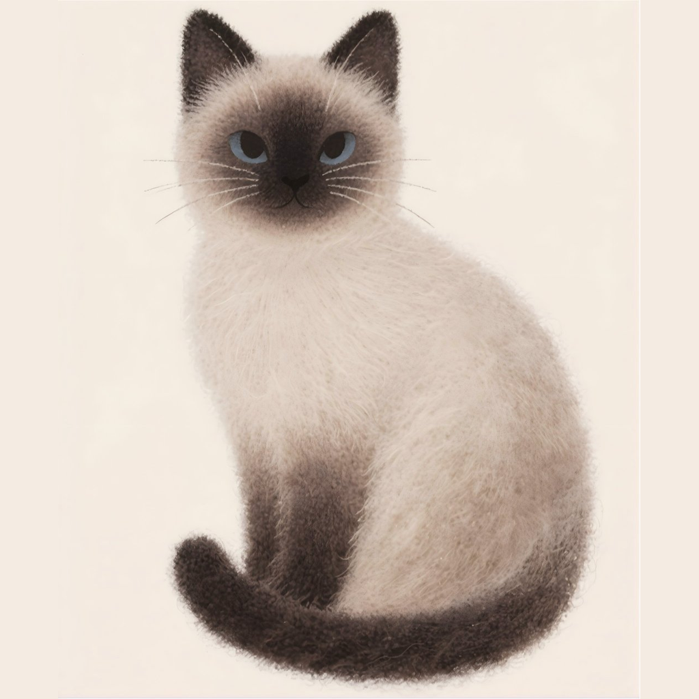

<div align="center">
  
  <h1>KelivoMeow</h1>

**Kelivo 的个人定制版** —— 更细的字号控制、独立的应用身份，可与原版并存

<p>
  <a href="https://github.com/PasleySage/kelivo/releases/latest"></a>
  
  <a href="https://github.com/Chevey339/kelivo"></a>
</p>

</div>

---

## 这是什么

KelivoMeow 是 [Kelivo](https://github.com/Chevey339/kelivo) 的 fork，跟随上游更新，只叠加少量改动：

- **字号缩放**：上游只有「聊天字体大小」一档，这里补上「界面」与「输入框」两档，并让固定尺寸的容器与头像一起缩放
- **独立身份**：自己的包名、可执行文件名与数据目录，可与官方 Kelivo 同机共存
- **更新入口指向本仓库**：应用内「检查更新」不再把你导向官方下载页

除此之外，功能、UI 与架构与上游保持一致。当前基线：上游 **`v1.3.5`**（`a03255cb`），实际同步至上游 **`master`**（`4857da60`）。

## 与上游的差异

### 1. 字号缩放

| 设置项 | 来源 | 作用范围 |
| --- | --- | --- |
| 聊天字体大小 | 上游 | 消息正文 |
| **界面字体大小** | **本 fork** | 菜单、设置、列表等全局 UI 文字 |
| **输入框字体大小** | **本 fork** | 输入框与编辑区 |

三档互相独立，跟随系统 `textScaler`，不破坏 Flutter 自身的字号继承。同时固定尺寸的容器与头像统一走 `scaledDim` / `scaledAvatarSize` 包装，放大字号后不会出现「字变大了但盒子没跟着变」的错位。

### 2. 独立身份

| | 官方 Kelivo | KelivoMeow |
| --- | --- | --- |
| Android 包名 | `com.psyche.kelivo` | `com.psyche.kelivomeow.app` |
| Windows 可执行文件 | `kelivo.exe` | `KelivoMeow.exe` |
| 应用数据目录 | `com.psyche\kelivo` | `com.psyche\kelivomeow` |

两套应用可以同时安装、各自独立使用，互不干扰。

### 3. 更新检查

上游 `update.json` 里各平台的下载链接原本都指向官方站点。本版统一改写为本仓库的 Releases 页——将来提示「有新版本」时，点进去不会变成安装官方 Kelivo。

## 下载

| 平台 | 文件 | 说明 |
| --- | --- | --- |
| Windows | `KelivoMeow_windows_<版本>_setup.exe` | **推荐**，带安装向导与卸载项 |
| Windows | `KelivoMeow_windows_<版本>.zip` | 绿色版，解压即用 |
| Android | `KelivoMeow_android_<版本>.apk` | 通用包，含 `arm64-v8a` / `armeabi-v7a` / `x86_64` |

全部见 [Releases](https://github.com/PasleySage/kelivo/releases) 页。

## 安装

**Windows**

1. 运行 `..._setup.exe`，在向导中选择安装目录（默认为系统程序目录，可改到其他盘）
2. 安装包未做代码签名，SmartScreen 可能提示「未知发布者」→ 选择「更多信息 → 仍要运行」
3. 依赖 **WebView2 Runtime**：Windows 11 自带；Windows 10 若缺失，内置浏览器会白屏，需从微软官网安装 Evergreen Runtime

**Android**

允许「安装未知来源应用」后直接安装即可。

## 数据与共存

- 应用数据位于 `%APPDATA%\com.psyche\kelivomeow`（Android 为应用私有目录）
- **安装、升级、卸载都不会删除这些数据**，要彻底清理需手动删除该目录
- 与官方 Kelivo 使用不同数据目录，可并存；但**安装版与绿色版共享同一目录，不要同时运行两份**

## 与上游同步

```
Chevey339/kelivo                                ← 上游
    └── PasleySage/kelivo (feat-kelivomeow-skill)    ← 本仓库（默认分支）
```

- 上游发版后，本分支 rebase 到上游 `master`，冲突只集中在少数改动过的文件
- 定制改动尽量收在「字号缩放包装」与「身份配置」两处，不碰上游业务逻辑，便于长期跟进
- 上游新增界面若有固定尺寸，需要补一次缩放包装，否则会出现局部不缩放

## 构建

| 依赖 | 版本 |
| --- | --- |
| Flutter | ≥ 3.44.9（实测 3.47.6） |
| Dart SDK | ^3.12.1 |
| JDK | 21（Android） |
| Android NDK | 28.2.13676358 |
| Rust | `aarch64-linux-android` / `armeabi-v7a` / `x86_64-linux-android` 目标 |

```bash
flutter pub get

# Windows
flutter build windows --release

# Android（KelivoMeow 身份）
flutter build apk --release -PmeowTarget=kelivomeow
```

- Windows 构建需要 Visual Studio 的 C++ 与 ATL 组件（`flutter_secure_storage` 依赖）
- 原生扩展（`super_native_extensions`、`sherpa-onnx` 等）经 cargokit 编译，需要可用的 Rust 工具链

## 已知限制

- **Windows 上系统「粗体文本」开关不生效**：上游 `AppFontWeights.normalize()` 的字重映射目前只对 Android 生效，Windows 直接返回原字重（对应上游 issue [#1054](https://github.com/Chevey339/kelivo/issues/1054) 的 Bug A）
- 三档字号缩放的完整实现尚未合入上游，见上游 PR [#892](https://github.com/Chevey339/kelivo/pull/892)
- 未做代码签名，安装包在 SmartScreen 下会显示为未知发布者

## 致谢

- [Chevey339/kelivo](https://github.com/Chevey339/kelivo) —— 本项目的全部基础，出色的开源 LLM 客户端
- 上游 Kelivo 的中文文档见 [`README_ZH_CN.md`](README_ZH_CN.md)

## License

沿用上游 [Kelivo](https://github.com/Chevey339/kelivo) 的开源协议，详见 [LICENSE](https://github.com/Chevey339/kelivo/blob/master/LICENSE)。
